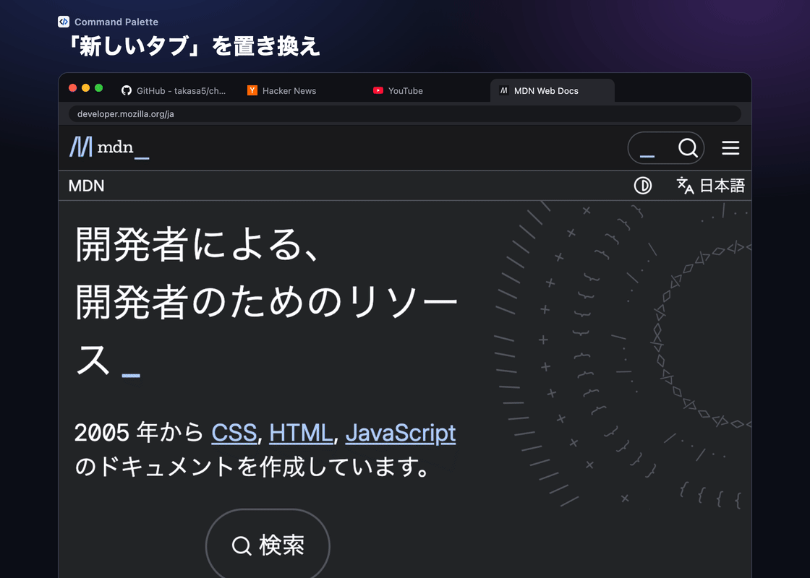

<h1 align="center">
  <br />
  Command Palette
</h1>

<p align="center"><a href="README.md">English</a> | 日本語</p>

<p align="center">
  <a href="https://microsoftedge.microsoft.com/addons/detail/agmjaaiokeicfoddncoeghilmhjcmceh"></a>
</p>

Arc のコマンドパレットの操作感を、Chrome のまま使うための拡張機能。`Cmd+T` でパレットを開き、ブラウザ操作、タブ切り替え、ブックマークと履歴の検索、URL を開く、Web 検索をキーボードで行える。



## インストール

[Microsoft Edge アドオン](https://microsoftedge.microsoft.com/addons/detail/agmjaaiokeicfoddncoeghilmhjcmceh)から入れる。新しいタブページの変更について確認が出たら、変更を維持する。

ソースから Chrome や Edge に読み込むときは、次のようにする。

1. `chrome://extensions` を開き、右上の「デベロッパー モード」をオンにする
2. 「パッケージ化されていない拡張機能を読み込む」でこのフォルダを選ぶ
3. 新しいタブページの変更について確認が出たら、変更を維持する

## 使い方

| キー | 動作 |
|---|---|
| `Cmd+T` | パレットを開く |
| `Cmd+Shift+S` | 今のページの上にパレットを開く |
| `↑` `↓` / `Ctrl+P` `Ctrl+N` | 候補を移動 |
| `Enter` | 実行 |
| `Shift+Enter` / `Shift+クリック` | 別ウィンドウのタブを、今のウィンドウへ移動して開く |
| `Shift+Delete` | 選んでいる履歴の候補を、履歴から削除 |
| `Tab` | 空の入力でコマンドの絞り込み、登録したキーワードでサイト内検索に入る |
| `Backspace` | 入力が空のとき、1 つ前に戻る |
| `Esc` | 閉じて元のタブに戻る |

## 特徴

### Arc のような操作感

* **新しいタブがパレットになる**: 新しいタブを開くと、アドレスバーの代わりにパレットが開く
* **30 以上のブラウザ操作**: タブやウィンドウの操作、ズーム、Chrome の設定ページを開くなどを、パレットから名前で実行できる
* **放置タブの一括クローズ**: `Archive Stale Tabs` で、しばらく見ていないタブを全ウィンドウからまとめて閉じる
* **サイト内検索**: Chrome のカスタム検索のように、キーワードを入れてそのサイトを検索する
* **お気に入りとピン**: Gmail のように開いておくサイトを、名前や `メール` などの別名で上位に出し、開いているタブがあればそこへ移る。Chrome のピンを Arc のお気に入りのように扱い、新しいウィンドウにも引き継ぐ

### Chrome の機能をそのまま使う

* **ブックマークをフォルダでたどる**: Chrome のブックマークを、フォルダ名で絞り込んだり、フォルダの中に入って一覧したりできる
* **リーディングリスト**: Chrome のリーディングリストへの追加、既読にする、一覧から開くをパレットから行える
* **独自のデータを持たない**: タブ、ブックマーク、履歴、リーディングリストは Chrome のものを使うので、移行の手間がなく、拡張機能を外しても元のまま残る
* **タブ移動**: 別ウィンドウのタブを、ページの状態を保ったまま今のウィンドウへ移動できる

### そのほか

* **日本語と英語**: 画面はブラウザの言語に合わせて日本語か英語で表示する。どちらでも英語、日本語、ひらがなで検索できる
* **よく選ぶ候補を優先**: パレットでよく選ぶページやコマンドほど、候補の上に出す

設定は `Command Palette Settings` コマンドで開く。

## テスト

```sh
npm test
```

## Inspired by [Arc](https://arc.net/)

Rest in peace.
