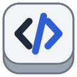
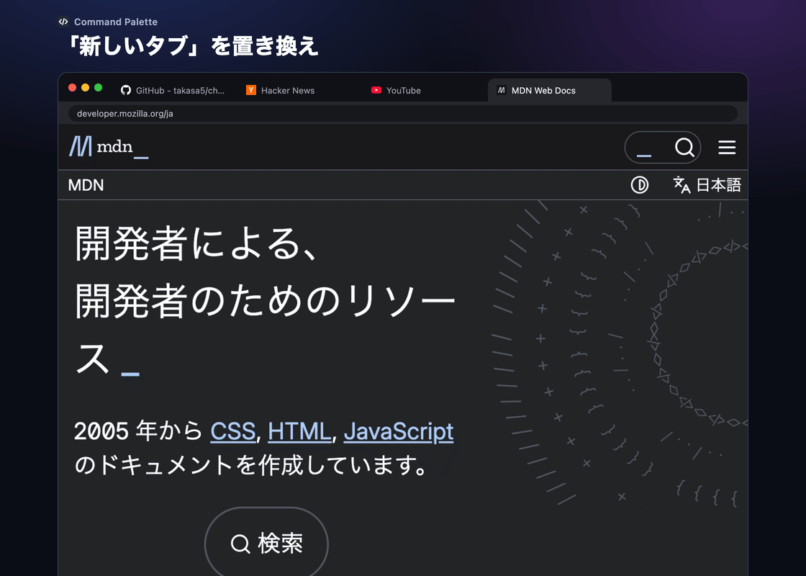

<h1 align="center">
  <br />
  Command Palette
</h1>

`Cmd+T` で開くコマンドパレットの Chrome 拡張機能。ブラウザ操作、タブ切り替え、ブックマークと履歴の検索、URL を開く、Web 検索をキーボードで行える。



## インストール

1. `chrome://extensions` を開き、右上の「デベロッパー モード」をオンにする
2. 「パッケージ化されていない拡張機能を読み込む」でこのフォルダを選ぶ
3. 新しいタブページの変更について確認が出たら、変更を維持する

## 使い方

| キー | 動作 |
|---|---|
| `Cmd+T` | パレットを開く |
| `Cmd+Shift+S` | 今のページの上にパレットを開く |
| `↑` `↓` / `Ctrl+P` `Ctrl+N` | 候補を移動 |
| `Enter` | 実行 |
| `Shift+Enter` / `Shift+クリック` | 別ウィンドウのタブを、今のウィンドウへ移動して開く |
| `Tab` | 空の入力でコマンドの絞り込み、`x` で X のアカウント選択、登録したキーワードでサイト内検索に入る |
| `Backspace` | 入力が空のとき、1 つ前に戻る |
| `Esc` | 閉じて元のタブに戻る |

## 特徴

* **日本語検索**: 英語、日本語、ひらがなのどれでも検索できる（コマンド一覧は `commands.js`）
* **Google サービス優先**: `mail`、`地図` などで Gmail、マップなどを候補の上位に出す。開いているタブがあればそこへ移動する（一覧は `google-services.js`）
* **フォルダ検索**: ブックマークをフォルダ名でも引け、`仕事 repo` のように続けて絞り込める。候補のフォルダの中に入り、その中だけを全件表示して絞り込むこともできる
* **タブ移動**: 別ウィンドウのタブを、ページの状態を保ったまま今のウィンドウへ移動できる。ピンのタブは移動せず今のウィンドウで開いてピンし、元のピンはサイトのトップへ戻す
* **ピン付きの新規ウィンドウ**: `New Window` で、今のウィンドウのピンをサイトのトップで開く
* **放置タブの一括クローズ**: `Archive Stale Tabs` で、最後に見てから 6 時間以上たったタブを全ウィンドウから確認なしで閉じる
* **X アカウント切り替え**: X のアカウントを選んで切り替え、ホームを開く（アカウントは設定で登録するか、X から読み込む）
* **サイト内検索**: Chrome のカスタム検索のように、キーワード + `Tab` でそのサイトを検索する。設定で `gh GitHub https://github.com/search?q=%s` のように 1 行に「キーワード 名前 URL」で登録する

設定は `Command Palette Settings` コマンドで開く。

## テスト

```sh
npm test
```
