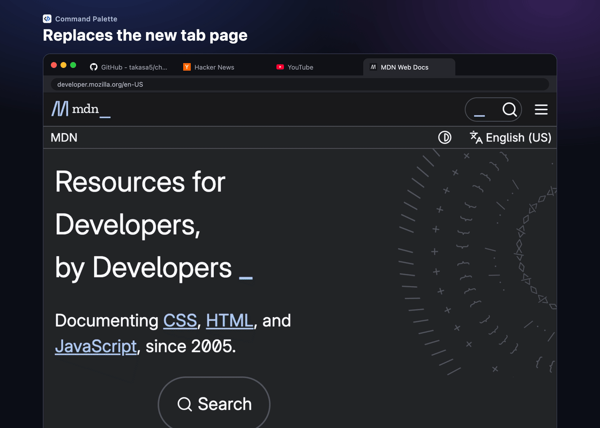

<h1 align="center">
  <br />
  Command Palette
</h1>

<p align="center">English | <a href="README.ja.md">日本語</a></p>

<p align="center">
  <a href="https://microsoftedge.microsoft.com/addons/detail/agmjaaiokeicfoddncoeghilmhjcmceh"></a>
</p>

<p align="center">
  <a href="https://microsoftedge.microsoft.com/addons/detail/agmjaaiokeicfoddncoeghilmhjcmceh"></a>
</p>

A Chrome extension that brings the feel of Arc's command palette to Chrome. Press `Cmd+T` to open the palette and control the browser, switch tabs, search bookmarks and history, open URLs, and search the web from the keyboard.



## Installation

Install it from [Microsoft Edge Add-ons](https://microsoftedge.microsoft.com/addons/detail/agmjaaiokeicfoddncoeghilmhjcmceh). When Edge asks about the new tab page change, choose to keep it.

To load it from source in Chrome or Edge:

1. Open `chrome://extensions` and turn on "Developer mode" in the top right
2. Click "Load unpacked" and select this folder
3. If Chrome asks about the new tab page change, choose to keep it

## Usage

| Key | Action |
|---|---|
| `Cmd+T` | Open the palette |
| `Cmd+Shift+S` | Open the palette over the current page |
| `↑` `↓` / `Ctrl+P` `Ctrl+N` | Move through results |
| `Enter` | Run |
| `Shift+Enter` / `Shift+Click` | Move a tab from another window into the current window and open it |
| `Shift+Delete` | Remove the selected history result from history |
| `Tab` | On empty input, filter to commands; after a registered keyword, start a site search |
| `Backspace` | On empty input, go back one step |
| `Esc` | Close and return to the previous tab |

## Features

### Feels like Arc

* **New tab is the palette**: Opening a new tab opens the palette instead of the address bar
* **30+ browser actions**: Run tab and window actions, zoom, open Chrome's settings pages, and more by name from the palette
* **Archive stale tabs**: `Archive Stale Tabs` closes tabs you haven't looked at in a while, across all windows
* **Site search**: Like Chrome's custom search engines, type a keyword to search that site
* **Favorites and pins**: Sites you keep open, like Gmail, rank at the top by name or alias, and jump to the open tab if there is one. Chrome's pinned tabs work like Arc's favorites and carry over to new windows

### Built on Chrome, not around it

* **Browse bookmarks by folder**: Filter Chrome bookmarks by folder name, or step into a folder to list its contents
* **Reading list**: Add to, mark as read, and open from Chrome's reading list in the palette
* **No data of its own**: Tabs, bookmarks, history, and the reading list are Chrome's own, so there is nothing to migrate and everything stays as it was if you remove the extension
* **Move tabs**: Move a tab from another window into the current one, keeping the page's state

### Also

* **Japanese and English**: The UI follows the browser's language, in Japanese or English. Either way, you can search in English, Japanese, or hiragana
* **Frequent picks first**: Pages and commands you pick often in the palette rank higher

Open settings with the `Command Palette Settings` command.

## Tests

```sh
npm test
```

## Inspired by [Arc](https://arc.net/)

Rest in peace.
