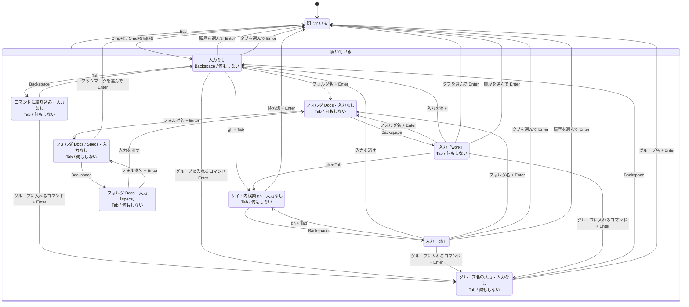

# パレットの状態遷移

このファイルは `npm run model` が [palette.qnt](../palette.qnt) から作る。手で書き換えない。

新しいタブで開いたときと、ページに重ねたときの遷移は同じ形なので、開き方を除いてまとめている。
片方にしかない遷移は、表の「開き方」の列に書く。
状態の中の「操作 / 何もしない」は、押しても状態が変わらない操作（内部遷移）を表す。

| 状態 | 操作 | 次の状態 | 開き方 |
| --- | --- | --- | --- |
| 閉じている | Cmd+T | 入力なし |  |
| 閉じている | Cmd+Shift+S | 入力なし |  |
| 入力なし | フォルダ名 + Enter | フォルダ Docs・入力なし |  |
| 入力なし | Tab | コマンドに絞り込み・入力なし |  |
| 入力なし | gh + Tab | サイト内検索 gh・入力なし |  |
| 入力なし | グループに入れるコマンド + Enter | グループ名の入力・入力なし |  |
| 入力なし | Backspace | 入力なし |  |
| 入力なし | Esc | 閉じている |  |
| 入力なし | タブを選んで Enter | 閉じている |  |
| 入力なし | 履歴を選んで Enter | 閉じている |  |
| 入力「gh」 | 入力を消す | 入力なし |  |
| 入力「gh」 | フォルダ名 + Enter | フォルダ Docs・入力なし |  |
| 入力「gh」 | gh + Tab | サイト内検索 gh・入力なし |  |
| 入力「gh」 | グループに入れるコマンド + Enter | グループ名の入力・入力なし |  |
| 入力「gh」 | Esc | 閉じている |  |
| 入力「gh」 | タブを選んで Enter | 閉じている |  |
| 入力「gh」 | 履歴を選んで Enter | 閉じている |  |
| 入力「work」 | 入力を消す | 入力なし |  |
| 入力「work」 | フォルダ名 + Enter | フォルダ Docs・入力なし |  |
| 入力「work」 | gh + Tab | サイト内検索 gh・入力なし |  |
| 入力「work」 | グループに入れるコマンド + Enter | グループ名の入力・入力なし |  |
| 入力「work」 | Tab | 入力「work」 |  |
| 入力「work」 | Esc | 閉じている |  |
| 入力「work」 | タブを選んで Enter | 閉じている |  |
| 入力「work」 | 履歴を選んで Enter | 閉じている |  |
| コマンドに絞り込み・入力なし | グループに入れるコマンド + Enter | グループ名の入力・入力なし |  |
| コマンドに絞り込み・入力なし | Backspace | 入力なし |  |
| コマンドに絞り込み・入力なし | Tab | コマンドに絞り込み・入力なし |  |
| コマンドに絞り込み・入力なし | Esc | 閉じている |  |
| サイト内検索 gh・入力なし | Backspace | 入力「gh」 |  |
| サイト内検索 gh・入力なし | Tab | サイト内検索 gh・入力なし |  |
| サイト内検索 gh・入力なし | Esc | 閉じている |  |
| サイト内検索 gh・入力なし | 検索語 + Enter | 閉じている |  |
| グループ名の入力・入力なし | Backspace | 入力なし |  |
| グループ名の入力・入力なし | Tab | グループ名の入力・入力なし |  |
| グループ名の入力・入力なし | Esc | 閉じている |  |
| グループ名の入力・入力なし | グループ名 + Enter | 閉じている |  |
| フォルダ Docs・入力なし | フォルダ名 + Enter | フォルダ Docs / Specs・入力なし |  |
| フォルダ Docs・入力なし | Backspace | 入力「work」 |  |
| フォルダ Docs・入力なし | Tab | フォルダ Docs・入力なし |  |
| フォルダ Docs・入力なし | Esc | 閉じている |  |
| フォルダ Docs・入力「specs」 | 入力を消す | フォルダ Docs・入力なし |  |
| フォルダ Docs・入力「specs」 | フォルダ名 + Enter | フォルダ Docs / Specs・入力なし |  |
| フォルダ Docs・入力「specs」 | Tab | フォルダ Docs・入力「specs」 |  |
| フォルダ Docs・入力「specs」 | Esc | 閉じている |  |
| フォルダ Docs / Specs・入力なし | Backspace | フォルダ Docs・入力「specs」 |  |
| フォルダ Docs / Specs・入力なし | Tab | フォルダ Docs / Specs・入力なし |  |
| フォルダ Docs / Specs・入力なし | Esc | 閉じている |  |
| フォルダ Docs / Specs・入力なし | ブックマークを選んで Enter | 閉じている |  |

E2E では、上の遷移を開き方ごとにすべて通す 8 本の操作列（[paths.json](paths.json)、計 204 操作）を実物で再生する。
